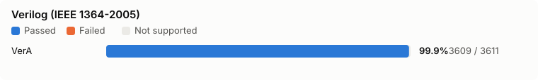
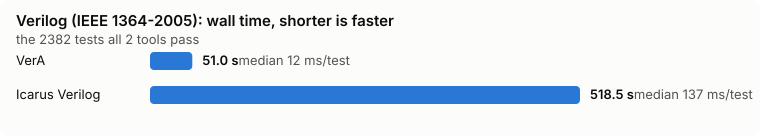
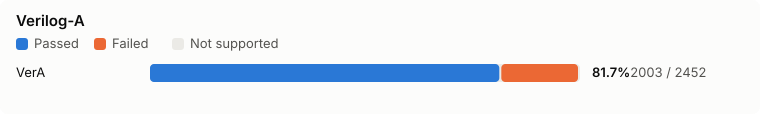
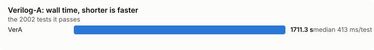
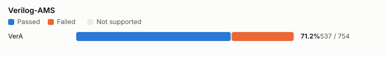
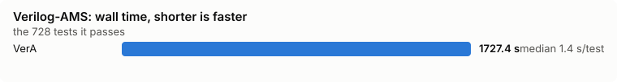
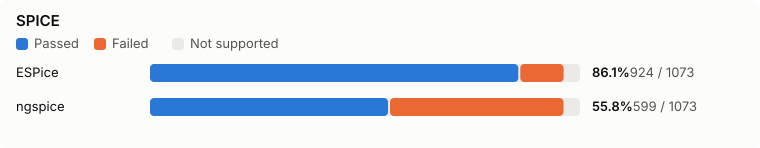
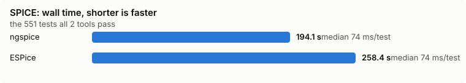

# VAMS Conformance Suite

A conformance and torture suite for Verilog-AMS and its three sublanguages:
Verilog-A (Annex C), IEEE 1364-2005 Verilog, and the SPICE compatibility of
Annex E. It holds hand-written tests that cite the clause they check, pins
larger upstream suites as git submodules, and runs any tool against both with
one C harness, `conform`.

The harness knows no tool. A tool is a config file of shell commands, so
VerA, OpenVAF-Reloaded, Icarus Verilog, Verilator and ngspice run the same
tests and are judged by the same rules.

## Quick start

```sh
git clone --recurse-submodules --shallow-submodules https://github.com/OpenFAT/VAMS-Conformance-Suite
cd VAMS-Conformance-Suite
nix develop                       # conform, openvaf-r, ngspice, iverilog, verilator
conform -t tools/iverilog.conf -j 16 tests/verilog external/ivtest.manifest
conform -t tools/openvaf.conf  -j 16 tests/verilog-a external/va-models.manifest
```

Without Nix, build the harness with `cc -O2 -o conform harness/conform.c -lm`
and put the tools on `PATH`.

Every non-passing test prints one line, then a summary:

```
FAIL  verilog-a/ch05_analog_behavior/slew_rate.va: compile exited 65
XPASS verilog/09_behavioral_modeling/case_default.v: expected to fail, passed

2215 tests: 955 passed, 0 compile-only, 1063 failed, 197 skipped, 0 xfail, 0 xpass
```

`conform` exits 1 on any FAIL or XPASS. `-o results.tsv` writes every
verdict with its wall time in milliseconds; `-x tools/<tool>.xfail` turns known failures into XFAIL, so a CI gate
fails only when something changes. `harness/selftest.sh` feeds the harness a
scripted fake tool and checks every verdict (`nix flake check` runs it).

## Layout

| Path | Contents |
|---|---|
| `tests/verilog-a/` | Analog-only tests: the Annex C subset. A Verilog-A compiler must handle all of them. |
| `tests/verilog-ams/` | Tests needing the full language: digital and mixed-signal constructs, VPI. |
| `tests/verilog/` | IEEE 1364-2005 tests by clause (`03_lexical_conventions` ... `A_formal_syntax`, `pli`). |
| `tests/spice/` | Annex E: SPICE primitives, model cards and netlists seen from Verilog-AMS. |
| `tests/netlist/` | SPICE decks by analysis (`op`, `dc`, `tran`, `ac`, `noise`, `pss`, `hb`, ...), each with a `.expected.json` oracle. |
| `tests/include/` | `check.vh`, the `CHECK` assertion macros, and `erfc.vh`. |
| `external/` | Upstream suites as submodules, one `<suite>.manifest` each, and `manifests.py`, which writes them. |
| `harness/` | `conform.c` and its selftest. |
| `tools/` | One `<tool>.conf` per tool, adapters, and `<tool>.xfail` baselines. |

Chapter directories follow the Verilog-AMS LRM 2023 (`ch05_analog_behavior`,
`annex_a_syntax`, ...). A test is named after the behavior it checks; a test
of a prohibition ends in `_rejected`.

The `tests/` tree was imported from VerA's fixtures and split by language: a
source that uses anything Annex C excludes from Verilog-A (digital behavior,
`wreal`, `discrete`, `===`, x/z literals, ...) is Verilog-AMS. `tests/netlist/`
was imported from ESPice's fixtures. Both are Apache-2.0.

## Writing a test

A test is a `.va`, `.vams`, `.v` or `.c` file with at least one `//!` line, or
a `.v` with a `<stem>.expected.txt` beside it.

```verilog
// §4.5.7: absdelay(x, td) is x delayed by td, even when td is shorter than a step.
//! lrm 4.5.7
//! bias V(n) = 0
//! wave V(p) = 0, 1, 2, 3
//! time 0, 1n, 2n, 3n
//! analysis tran
`include "check.vh"
module absdelay_short(p, n);
  inout p, n; electrical p, n;
  analog begin
    `CHECK("output(t) == input(t - td)", absdelay(V(p, n), 0.5n) - max($abstime * 1e9 - 0.5, 0.0), 0.0, 1e-12);
    I(p, n) <+ absdelay(V(p, n), 0.5n) * 1.0e-3;
  end
endmodule
```

Two kinds of directive:

- **`//!` lines describe the test.** The tool reads the testbench ones
  (`bias`, `param`, `temp`, `analysis`, `time`, `wave`, `sweep`, `solve`,
  `noise`, `acdyn`, `spice`, ...: the vocabulary of VerA's `--run`) and drives
  the model with them. The harness reads only the verdict ones below.
- **`//@` lines say how to invoke the tool.** The harness exports them as
  environment variables and never interprets them further.

| Line | Read by | Meaning |
|---|---|---|
| `//! lrm 4.5.7`, `//! inherited IEEE 1364-2005 3.8` | nobody | the clause, or `clause:sentence`, the test checks |
| `//! reject <note>` | harness | the tool must refuse the source with a diagnostic (exit 1–125, not a crash or timeout). The note names the expected error, often as VerA's code; the harness does not match it. |
| `//! reject-run <note>` | harness | compiles, and the run must fail |
| `//! exit N` | harness | the run's exit status |
| `//! checks N` | harness | exactly N `ok=` lines |
| `//! stdout TEXT` | harness | stdout contains TEXT |
| `//! expect stdout GOLD` | harness | stdout equals GOLD (beside the test) instead of `<stem>.expected.txt`; a GOLD that is not there fails the test |
| `//! expect vcd OUT == GOLD` | harness | the VCD the run writes equals GOLD, `$date`/`$version` bodies aside |
| `//! neighbour FILE` | nobody | the legal twin of a `_rejected` test |
| `//@ files A.v B.v` | tool | more sources (exported absolute as `CONFORM_FILES`) |
| `//@ libmap X.map`, `//@ liblist LIB`, `//@ std 1364-2001` | tool | IEEE 1364 clause 13 configuration and the `begin_keywords` set |
| `//@ protect-keys K.json` | tool | the key file that decrypts an IEEE 1364 clause 28 envelope |

### The verdict

1. A test with only metadata (`lrm`, `reject`, ...) is an accept or reject
   test: the compile stage decides it.
2. Any other `//!` line, a `CHECK` macro, or an `.expected.txt` makes it a run
   test. The run must exit 0 (or `//! exit N`), and then:
   - stdout must equal `<stem>.expected.txt` byte for byte;
   - stderr must contain `<stem>.expected.stderr.txt` (stderr also carries the
     tool's own diagnostics, so containment, not equality);
   - no line may say `ok=0`, and a test that uses `CHECK` must print at least
     one `ok=`: a check that never ran is a failure.

`check.vh`'s macros print `NAME got=X want=Y ok=1|0` with `$strobe`, so a
self-checking test needs nothing but a tool that runs `$strobe`.

## Tool configs

A config maps `stage.language` to a shell command; `#` starts a comment.

```
compile.verilog = iverilog -g2005 -o "$CONFORM_WORK/sim.vvp" "$CONFORM_SRC" $CONFORM_FILES
run.verilog     = vvp -n "$CONFORM_WORK/sim.vvp"
```

- **Stages:** `compile` then `run`. A tool may define either or both. With
  `compile` only, a run test that compiles counts as *compile-only*, and a
  `reject-run` test is skipped. With `run` only, the run does both; for an
  accept test (compiling is enough) it gets `CONFORM_COMPILE_ONLY=1` and may
  stop after compiling.
- **Languages:** the directory under `tests/` (`verilog-a`, `verilog-ams`,
  `verilog`, `spice`), `vpi` for a `.c` test, `netlist` for a `.sp` deck
  wherever it is filed, or a manifest row's first
  column (`netlist` for SPICE decks). `stage.*` is a fallback. A language with
  no command is skipped.
- **Exit 77** from a stage means the tool cannot express this test (an adapter
  without transient support, say): SKIP, not FAIL.
- Each test runs in its own scratch directory, `CONFORM_WORK`. Files the test
  names that sit beside it are linked in, so a test that reads `x.hex` finds
  it and a test that writes `x.log` writes into scratch, not the tree.

| Variable | Value |
|---|---|
| `CONFORM_SRC` | the test source, absolute |
| `CONFORM_DIR`, `CONFORM_STEM` | its directory; its name without extension |
| `CONFORM_REL`, `CONFORM_LANG` | its path from the suite root; its language |
| `CONFORM_WORK` | the scratch directory, also the working directory |
| `CONFORM_INCLUDE` | `tests/include` (for a manifest test, the suite's root) |
| `CONFORM_TOOLDIR` | the config's directory, for adapters beside it |
| `CONFORM_FILES`, `CONFORM_LIBMAP`, `CONFORM_LIBLIST`, `CONFORM_STD`, `CONFORM_PROTECT_KEYS` | from `//@` lines |
| `CONFORM_COMPILE_ONLY` | `1` when only compiling is judged (see Stages) |
| `CONFORM_<KEY>` | from a manifest row's `KEY=VALUE` columns (a row sets these, not `//@` lines: `STD`, `INCDIR`, `DIRS` the directories its runner makes in the cwd, `DEFINES`, `SHIM` an include directory under `external/`). The harness reads `FILTER`, `RTOL`, `ATOL` and `DIFF=OUT:GOLD` (the file the run writes must equal GOLD, compared as `//! expect vcd`) |

| Config | Languages | Notes |
|---|---|---|
| `vera.conf` | all four | `vera --run`; run under VerA's own `nix develop`. Defaults to the sibling checkout `../Zig/VerA/zig-out/bin/vera` for now; `VERA=` overrides |
| `openvaf.conf` | `verilog-a`, `spice` | `openvaf-r` to OSDI, then `ngspice-osdi.py` runs the library in ngspice at the test's DC operating point and prints its `ok=` lines; transient, AC and noise testbenches SKIP |
| `iverilog.conf` | `verilog` | `iverilog` + `vvp` |
| `verilator.conf` | `verilog` | `verilator --binary --timing` |
| `ngspice.conf` | `netlist` | `tests/netlist/` through `rawcheck.py`, and the external decks |
| `espice.conf` | `netlist` | as `ngspice.conf`; `ESPICE=` overrides the executable |

### SPICE decks

A `.sp` deck in `tests/netlist/` is a test when a `<stem>.expected.json`
oracle sits beside it. The oracle lists the plots the simulator's binary raw
file must hold, each column's values and its `rtol`/`atol`, how rows match
(`exact`, `selected_rows`, interpolated `samples`, `unordered`), `.meas`
results, or `status: error` for a deck that must be refused. The tool's run
stage calls `tools/rawcheck.py` with its simulator command; rawcheck runs it in
the deck's directory and prints one `ok=` line per check:

```
run.netlist = python3 "$CONFORM_TOOLDIR/rawcheck.py" 'ngspice --batch ${RAW:+-r "$RAW"} "$DECK"'
```

Oracles that use a check kind rawcheck has not ported yet (pole-zero sets,
moments, THD, repeatability) SKIP. A deck in another dialect names it in its
oracle (`tokenizer: hspice`), passed on as `TOKENIZER`.

## Manifests

An upstream suite keeps its own files and its own idea of the right answer.
`external/manifests.py` reads that from each submodule and writes
`external/<suite>.manifest`, which `conform` takes like a directory:

```
#root iverilog/ivtest
verilog	ok	ivltests/always3.1.1A.v	gold/always3.1.1A.gold	STD=1364-2005	FILTER=grep -v '^VCD info'
```

Columns, tab-separated: language, want, source, gold (`-` for none), then
`KEY=VALUE` pairs exported as `CONFORM_KEY`. Paths are relative to `#root`.

| Want | Passes when |
|---|---|
| `ok` | compile and run exit 0; stdout equals the gold, if one is given |
| `passed` | as `ok`, and a line of stdout reads `PASSED` (ivtest's convention) |
| `compile` | the compile stage succeeds |
| `reject`, `reject-run` | as the `//!` directives |

Two keys change the gold comparison: `FILTER` is a shell command both stdout
and the gold pass through first (upstream's own filter, so a tool's banner
does not count), and `RTOL`/`ATOL` compare the numbers in them within
`atol + rtol·max(|a|, |b|)`. `STDERR` is text the run's stderr must contain (a reject-run's diagnostic). A test name is `<manifest>/<source>`, which is
also how an xfail file lists it.

Where the governing LRM (IEEE 1364-2005, VAMS-2023) decides a test
differently from its upstream suite, `external/expectations.tsv` overrides
the row's want and gold and names the clause, written into the row as
`LRM=`. Most are upstream tests of a construct the LRM forbids, now `reject`
(issue #1); the gold files it adds live in `external/gold/`. A name there that
no manifest has stops `manifests.py`.

| Manifest | Upstream | Selected | Rule |
|---|---|---:|---|
| `ivtest` | Icarus Verilog `ivtest` | 1854 | `regress-vlg.list` ("any simulator that supports standard Verilog") and the vvp JSON tests, without Icarus-only options or non-1364 system tasks |
| `sv-tests` | chipsalliance/sv-tests | 131 | tests whose text is IEEE 1364-2005 |
| `ispras-1364` | ISP RAS `ieee-1364-2005` | 327 | the standard's own examples; POSITIVE compile, NEGATIVE reject, VARYING left out |
| `openvaf` | OpenVAF-Reloaded | 65 | diagnostic tests (an `error` in the expected log means reject) and the integration-test models |
| `gnucap-modelgen` | gnucap-modelgen-verilog | 195 | model tests; `.error.` names reject |
| `va-models` | dwarning/VA-Models | 92 | every compact model must compile |
| `ngspice` | ngspice `tests/` | 108 | `make check` decks against their `.out` |

`external/Xyce_Regression` is pinned but has no manifest yet: its oracle is
`xyce_verify.pl`'s per-column tolerances over `.prn` files.

## Results

Every Monday `.github/workflows/conformance.yml` fetches each tool at its
latest version (`tools/ci.sh`: VerA and ESPice at their default branch,
OpenVAF-Reloaded at its newest release, the rest at nixpkgs-unstable), runs it
over every test and manifest, and redraws these charts with `tools/report.py`.
Each language gets two charts. Conformance is the tests a tool passes over
every test in the language: a test it cannot express counts against it, as
"not supported". Speed is the wall time `conform` measured per test (compile
and run), summed over the tests every charted tool passes, so each tool is
timed on the same work. Each tool runs on its own GitHub-hosted runner of the
same class, with as many tests in parallel as it has CPUs; treat differences
under about 20% as noise.

<!-- conformance:start -->
Measured 2026-10-26 by `.github/workflows/conformance.yml`, each tool at its latest version (`tools/ci.sh` says which).














<details><summary>The numbers</summary>

| Language | Tool | Version | Passed | Failed | Not supported | Conformance | Time on common tests |
|---|---|---|---:|---:|---:|---:|---:|
| Verilog (IEEE 1364-2005) | VerA | vera 0.20.0 | 3609 | 2 | 0 | 99.9% | 125.5 s (3609) |
| Verilog-A | VerA | vera 0.20.0 | 2452 | 0 | 0 | 100.0% | 2174.7 s (2452) |
| Verilog-AMS | VerA | vera 0.20.0 | 728 | 26 | 0 | 96.6% | 1727.4 s (728) |
| SPICE | ESPice | espice espice 0.3.0 (VerA 0.20.0 14541a6f966b2e96eca145546b36e4550078dc0f; backends: cpu) | 924 | 113 | 36 | 86.1% | 258.4 s (551) |
| SPICE | ngspice | ** ngspice-45 : Circuit level simulation program | 599 | 438 | 36 | 55.8% | 194.1 s (551) |

</details>
<!-- conformance:end -->

## License

The tests imported from VerA and ESPice are Apache-2.0. Each submodule keeps its own
license; nothing of theirs is copied into this tree.
